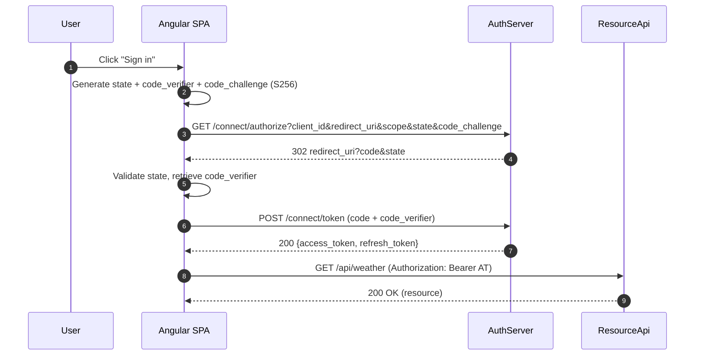
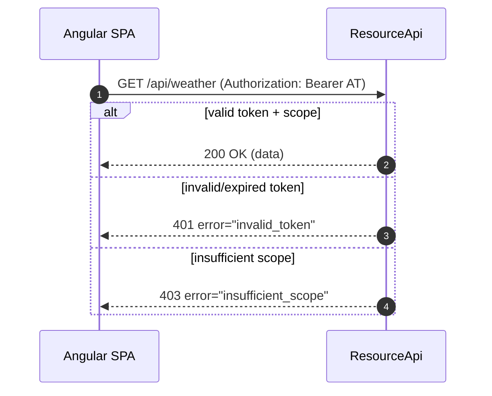

# Angular Client — OAuth 2.0 Public Client (Authorization Code + PKCE)

This Angular application is the **OAuth 2.0 Client** in the end-to-end solution.  
It implements the **Authorization Code Grant with PKCE** (RFC 6749 §4.1) and integrates with the **AuthServer** and **ResourceApi**.

---

## Overview

- **Type**: Public Client (no client_secret)
- **Grant Type**: Authorization Code + PKCE (S256)
- **Tokens**: Receives short-lived JWT Access Tokens and opaque Refresh Tokens
- **Discovery**: Dynamically loads `/.well-known/openid-configuration` from AuthServer
- **Storage**: Keeps tokens in `sessionStorage` (demo) — production may prefer in-memory
- **API Access**: Calls ResourceApi endpoints using Bearer tokens

---

## RFC Mapping

- **§2 Client Registration**  
  Registered in AuthServer with `client_id`, `redirect_uri`, `allowed_scopes`.  

- **§3 Protocol Endpoints**  
  Discovered from AuthServer’s `.well-known/openid-configuration`.  

- **§4.1 Authorization Code Grant (PKCE)**  
  Implemented via `HomeComponent.signIn()` and `CallbackComponent`.  

- **§1.4 Access Token / §1.5 Refresh Token**  
  Managed by `TokenService`.  

- **§7 Accessing Protected Resources**  
  Done by `HomeComponent.callWeather()`.  

---

## Key Files

- `src/app/shared/oidc-config.service.ts` — Loads discovery document.  
- `src/app/shared/pkce.ts` — Generates PKCE code_verifier & code_challenge.  
- `src/app/shared/token.service.ts` — Handles code exchange, refresh, and storage.  
- `src/app/pages/home/home.component.ts` — Start login, display config, call API.  
- `src/app/pages/callback/callback.component.ts` — Handle redirect, exchange code.  

---

## Sequence Diagrams

### Authorization Code + PKCE Flow


### Refresh Token Rotation
```mermaid
sequenceDiagram
  autonumber
  participant SPA as Angular SPA
  participant AS as AuthServer

  SPA->>AS: POST /connect/token (grant_type=refresh_token, RT_old)
  alt RT_old valid
    AS->>AS: Revoke RT_old; issue RT_new
    AS-->>SPA: 200 {access_token, refresh_token=RT_new}
  else RT_old reused
    AS->>AS: Revoke family
    AS-->>SPA: 400 {error:"invalid_grant"}
  end
```

### Resource API Access


---

## Testing with Postman & Angular

### 1. Run Angular
```bash
ng serve
```
App runs at `http://localhost:4200`.  

### 2. Start Authorization Code Flow
- Open `http://localhost:4200`
- Click **Sign in**
- Angular redirects to AuthServer `/connect/authorize`
- After login, AuthServer redirects back to `/callback` with `code`

### 3. Token Exchange
- Angular automatically exchanges `code` + `code_verifier` at `/connect/token`
- Stores `access_token` + `refresh_token` in sessionStorage

### 4. Call Resource API
- On Home page, click **Call Weather API**
- Angular sends `Authorization: Bearer <access_token>`
- ResourceApi responds with JSON (or RFC 6750 error)

### 5. Refresh Tokens
- Simulate expiry or click **Refresh**
- Angular posts `grant_type=refresh_token` to `/connect/token`
- New tokens issued; old refresh token revoked

---

## Postman-Specific Testing

You can also use Postman to test alongside Angular:

- Inspect Angular’s `sessionStorage` to copy `access_token` & `refresh_token`
- In Postman:
  - `GET http://localhost:5173/api/weather` with header `Authorization: Bearer {{access_token}}`
  - `POST {{token_endpoint}}` with body:  
    ```
    grant_type=refresh_token
    refresh_token={{refresh_token}}
    ```

---

## Security Notes

- PKCE S256 is mandatory for public clients.  
- `state` is validated to prevent CSRF.  
- Tokens are short-lived (access) and refresh tokens are rotated.  
- Storage in `sessionStorage` is for demo only; consider in-memory or silent refresh in production.  

---

## References
- [RFC 6749: OAuth 2.0 Authorization Framework](https://datatracker.ietf.org/doc/html/rfc6749)
- [RFC 6750: Bearer Token Usage](https://datatracker.ietf.org/doc/html/rfc6750)
- [RFC 8414: OAuth 2.0 AS Metadata](https://datatracker.ietf.org/doc/html/rfc8414)
- [RFC 7517: JSON Web Key](https://datatracker.ietf.org/doc/html/rfc7517)
