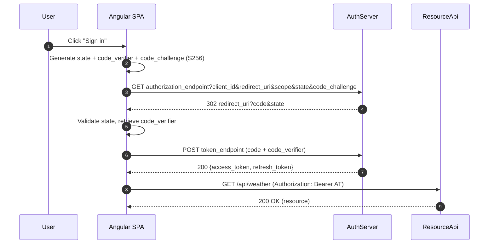
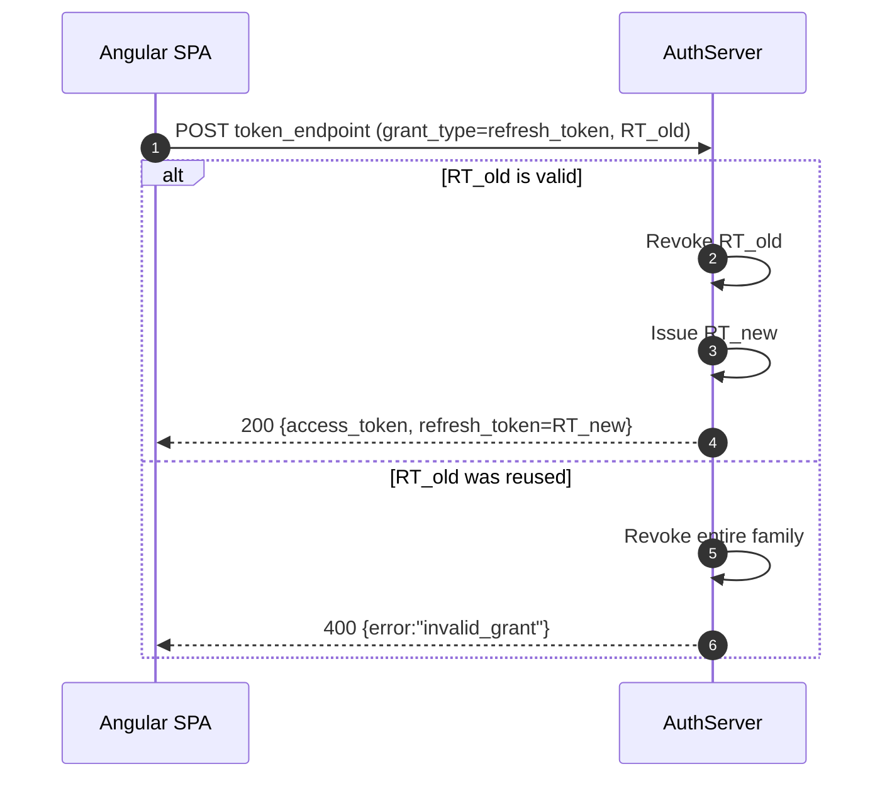
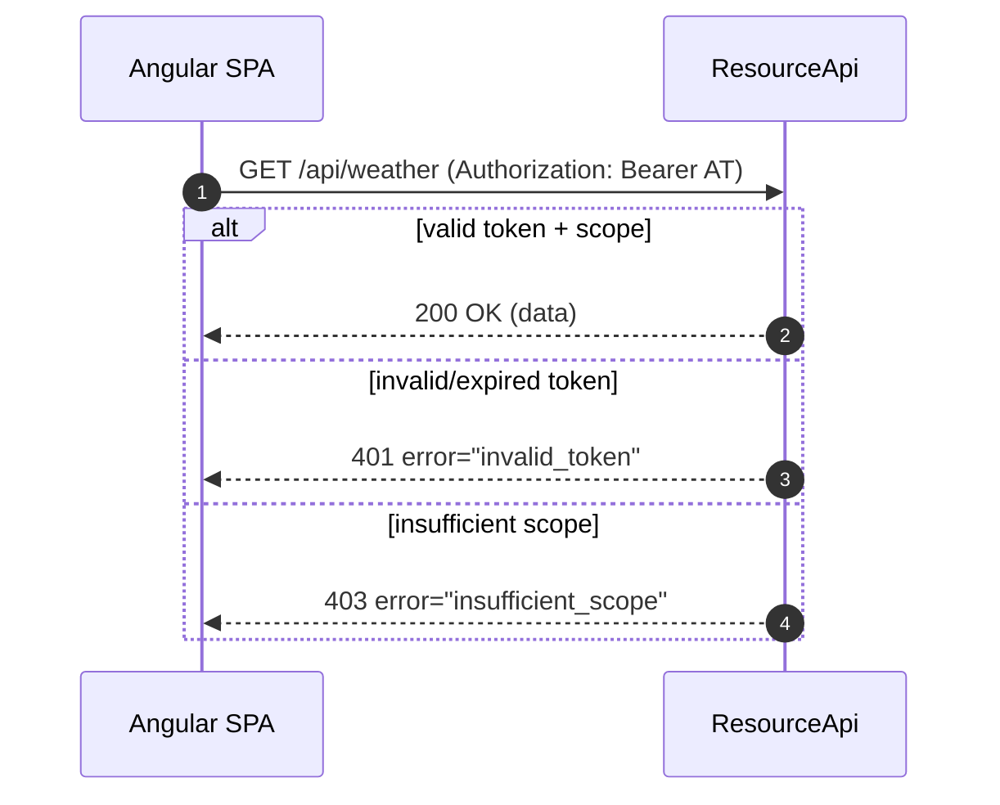

# oauth2-pkce-angular-client

[](https://angular.dev)
[](https://www.typescriptlang.org/)
[](LICENSE)

A small Angular single-page app that acts as an **OAuth 2.0 public client** and implements the **Authorization Code grant with PKCE (S256)** by hand, with no OAuth library. It discovers the authorization server's endpoints, sends the user to log in, exchanges the code for tokens, refreshes the access token, and calls a protected resource API with a bearer token.

It is a teaching and demo client. It is meant to show the protocol mechanics (RFC 6749, RFC 7636, RFC 6750) clearly, not to be a reusable auth library. It needs a compatible authorization server and resource API; see [Related](#related).

---

## Contents

- [Overview](#overview)
- [Flow diagrams](#flow-diagrams)
- [Features](#features)
- [RFC mapping](#rfc-mapping)
- [Prerequisites](#prerequisites)
- [Configuration](#configuration)
- [Install and run](#install-and-run)
- [Using it against an authorization server](#using-it-against-an-authorization-server)
- [Project structure](#project-structure)
- [Security notes and known issues](#security-notes-and-known-issues)
- [Tests](#tests)
- [Related](#related)
- [References](#references)
- [License](#license)

---

## Overview

| Aspect | Value |
|--------|-------|
| Client type | Public client (no `client_secret`) |
| Grant | Authorization Code + PKCE, `code_challenge_method=S256` |
| CSRF protection | Random `state` (`crypto.randomUUID()`), checked on callback |
| Endpoint discovery | Fetched at runtime from `{issuer}/oauth/.well-known/openid-configuration` |
| Token handling | Access token plus optional refresh token, kept in `sessionStorage` (demo choice) |
| Refresh | `grant_type=refresh_token`, sent automatically when the access token is expired or within 30 s of expiry |
| Resource call | `GET {resourceApi}/api/weather` with `Authorization: Bearer <access_token>` |
| HTTP | Native `fetch` (no `HttpClient` interceptor or route guard) |
| Framework | Angular 20.3 standalone components, built-in control flow (`@if`), strict TypeScript |

This is plain OAuth 2.0, not OpenID Connect login. The client requests only the `weather.read` scope, and it does not request or validate an `id_token` or `nonce`. It reads the OIDC discovery document only to find the endpoints.

---

## Flow diagrams

Endpoint paths come from the discovery document. They are not hard-coded in the client.

### Authorization Code + PKCE flow



### Refresh token rotation

This diagram shows the behaviour the client expects from the authorization server. Rotation and reuse detection happen on the server; this repo only sends the refresh request and stores whatever comes back. Refresh-token family revocation is the server's responsibility and hasn't been verified end to end with this client.



### Resource API access



When the resource API returns an error, the client shows the HTTP status and response body on the page. The `401`/`403` bodies above follow RFC 6750 and depend on the resource API.

---

## Features

- **PKCE by hand:** `code_verifier` from 64 random bytes (`crypto.getRandomValues`), `code_challenge` = base64url(SHA-256(verifier)) via WebCrypto (`src/app/shared/pkce.ts`)
- **State check:** a random `state` is stored before the redirect and must match on callback, or the flow stops with "State mismatch"
- **One-time artifacts:** the PKCE verifier and `state` are removed from `sessionStorage` after a successful code exchange
- **Discovery:** reads `authorization_endpoint`, `token_endpoint` and `jwks_uri` from the discovery document and shows them on the home page
- **Token exchange and refresh:** form-encoded `POST` to the token endpoint (`src/app/shared/token.service.ts`)
- **Expiry tracking:** tokens are treated as expired 30 s before `expires_in` runs out
- **Protected API call:** "Call Resource API" button, which refreshes first if needed and then calls `/api/weather`
- **Error surfacing:** discovery, token and API failures (including CORS and `401`) are shown on the page
- **Sign out:** clears tokens on the client only (no revocation or end-session call)

---

## RFC mapping

| RFC section | Where |
|-------------|-------|
| RFC 6749 §2 Client registration | The server must register `client_id`, `redirect_uri` and allowed scopes (see [Configuration](#configuration)) |
| RFC 6749 §3 / RFC 8414-style metadata | Endpoints come from the discovery document (`oidc-config.service.ts`) |
| RFC 6749 §4.1 + RFC 7636 Authorization Code with PKCE | `HomeComponent.signIn()` and `CallbackComponent` |
| RFC 6749 §6 Refreshing an access token | `TokenService.refresh()` |
| RFC 6749 §10.12 CSRF (`state`) | `CallbackComponent.ngOnInit()` |
| RFC 6750 Bearer token usage | `HomeComponent.callWeather()` |

---

## Prerequisites

| Tool | Version | Check |
|------|---------|-------|
| Node.js | `^20.19.0`, `^22.12.0` or `>=24.0.0` (Angular 20.3 engines) | `node -v` |
| npm | bundled with Node | `npm -v` |
| An OAuth 2.0 authorization server and resource API | see [Using it against an authorization server](#using-it-against-an-authorization-server) | -- |
| Chrome or Edge | only for `ng test` (Karma) | -- |

A global Angular CLI is not required; the commands below use `npx ng`.

Verified on 2026-10-27 with Node 24.18.0 and npm 11.16.0 on Windows 11: `npm ci --ignore-scripts` and `npx ng build` succeeded (plain `npm ci` was not run; the build did not need install scripts) (initial bundle about 233 kB raw, 66 kB transferred).

---

## Configuration

All settings are in **`src/environments/environment.ts`**. There is no separate production environment file and no `fileReplacements` entry in `angular.json`, so `ng build` uses this file too.

```ts
export const environment = {
  production: false,
  oauth: {
    issuer: 'http://localhost:5018',               // base URL of the authorization server
    clientId: 'demo-spa',                          // public client registered on that server
    redirectUri: 'http://localhost:4200/callback', // must match a registered redirect URI exactly
    scope: 'weather.read'
  },
  resourceApi: 'http://localhost:5173'             // base URL of the protected API
};
```

| Setting | Default | Used for |
|---------|---------|----------|
| `oauth.issuer` | `http://localhost:5018` | Discovery URL is built as `{issuer}/oauth/.well-known/openid-configuration` (`src/app/shared/oidc-config.service.ts`) |
| `oauth.clientId` | `demo-spa` | `client_id` on the authorize request and the code exchange |
| `oauth.redirectUri` | `http://localhost:4200/callback` | Must match the Angular route `callback` (`src/app/app.routes.ts`) and the server's registration |
| `oauth.scope` | `weather.read` | Requested scope; the resource API should require it |
| `resourceApi` | `http://localhost:5173` | Base URL for `GET /api/weather` |

The discovery path includes an `/oauth` prefix. A server that serves its metadata at the standard `{issuer}/.well-known/openid-configuration` needs a one-line change in `oidc-config.service.ts`.

---

## Install and run

The commands are the same in PowerShell and bash.

```bash
git clone https://github.com/HariVenkataKrishnaKotha/oauth2-pkce-angular-client.git
cd oauth2-pkce-angular-client
npm ci
npx ng serve          # http://localhost:4200
```

Production build (output in `dist/client-spa/`):

```bash
npx ng build
```

---

## Using it against an authorization server

The authorization server and resource API are not in this repo. Before you start the client, the server side must provide:

1. **Discovery** at `{issuer}/oauth/.well-known/openid-configuration` returning at least `authorization_endpoint` and `token_endpoint` (`jwks_uri` is displayed if present).
2. **A public client registration:** `client_id = demo-spa`, redirect URI `http://localhost:4200/callback`, Authorization Code grant with PKCE `S256`, the refresh-token grant, and the `weather.read` scope.
3. **Refresh requests without `client_id`:** the refresh request sends only `grant_type` and `refresh_token`, so the server must accept that from this public client. This hasn't been verified end to end.
4. **CORS** for origin `http://localhost:4200` on the discovery document, the token endpoint and the resource API, because the browser calls all three with `fetch`.
5. **A protected resource** `GET /api/weather` that accepts the access token as a bearer token and checks the `weather.read` scope.

Then:

1. Open http://localhost:4200. The home page loads the discovery document and lists the endpoints it found. If discovery fails, the error is shown on the page.
2. Click **Sign in**. The app generates `state` and the PKCE pair, stores them in `sessionStorage`, and redirects to the `authorization_endpoint`.
3. Log in on the authorization server. It redirects back to `/callback?code=...&state=...`.
4. The callback page checks `state`, exchanges `code` + `code_verifier` at the `token_endpoint`, stores the tokens and returns to the home page.
5. Click **Call Resource API**. If the access token is expired or about to expire, the app refreshes it first, then calls `/api/weather` and prints the JSON response.
6. Click **Sign out** to clear the stored tokens.

There is no manual "Refresh" button. To see a refresh, wait for the access token to expire (or shorten its lifetime on the server) and click **Call Resource API** again.

### Testing alongside Postman

- Copy `accessToken` and `refreshToken` from the `oauth_tokens` entry in the browser's `sessionStorage` (DevTools, Application tab).
- `GET {resourceApi}/api/weather` with header `Authorization: Bearer {{access_token}}`.
- `POST {{token_endpoint}}` with a form body:
  ```
  grant_type=refresh_token
  refresh_token={{refresh_token}}
  ```

---

## Project structure

```
oauth2-pkce-angular-client/
├── src/
│   ├── main.ts                              # Bootstraps AppComponent with provideRouter(routes)
│   ├── environments/environment.ts          # issuer, clientId, redirectUri, scope, resourceApi
│   └── app/
│       ├── app.component.ts                 # Root component (router outlet only)
│       ├── app.routes.ts                    # '' -> HomeComponent, 'callback' -> CallbackComponent
│       ├── pages/
│       │   ├── home/                        # Discovery display, sign in/out, resource API call
│       │   └── callback/                    # state check, code exchange, cleanup
│       ├── shared/
│       │   ├── oidc-config.service.ts       # Loads and caches the discovery document
│       │   ├── pkce.ts                      # randomString, sha256, b64url, pkcePair
│       │   └── token.service.ts             # Code exchange, refresh, expiry, sessionStorage
│       ├── app.ts / app.html / app.css      # Unused Angular CLI scaffold (see known issues)
│       ├── app.config.ts                    # Unused (main.ts provides the router directly)
│       └── app.spec.ts                      # Scaffold spec for the unused App component
├── angular.json
├── package.json                             # Package name: client-spa
└── LICENSE                                  # MIT
```

---

## Security notes and known issues

What the client does correctly:
- PKCE `S256` with a WebCrypto-generated verifier; no client secret in the browser
- `state` generated with `crypto.randomUUID()` and checked on callback
- PKCE verifier and `state` removed after a successful exchange
- No secrets in the repository: `environment.ts` holds only localhost URLs, a public client ID and a scope

Known issues (open):
- **Token logging:** `HomeComponent.callWeather()` (`src/app/pages/home/home.component.ts`) still has debug `console.log` calls that print the `Authorization` header, including the full bearer access token, plus the JWT segment lengths. Anyone with access to the browser console or captured logs can read the token. These lines should be removed.
- **Token storage:** access and refresh tokens are kept in `sessionStorage`, which any script running on the page (for example through XSS) can read. In-memory storage or a backend-for-frontend would be safer.
- **Plain HTTP:** the default issuer and resource API use `http://localhost`. Use HTTPS for anything beyond local development.
- **Partial cleanup:** if the code exchange fails, the PKCE verifier and `state` stay in `sessionStorage` until the tab is closed.
- **Local-only sign-out:** sign-out does not revoke the refresh token or end the server session.
- **No OIDC validation:** no `id_token` or `nonce` handling. This is fine for API authorization, but the client must not be used as an OIDC login.
- **Unused scaffold:** `app.ts`, `app.html`, `app.css` and `app.config.ts` are unused Angular CLI files.
- **Dependency advisories:** `npm audit` reports advisories in the dependency tree. They have not been triaged. Updating to the latest Angular release is on the to-do list.

---

## Tests

Current state (checked 2026-10-27): **one spec file, `src/app/app.spec.ts`, with 2 tests, and both pass.** They test the unused CLI scaffold component (`App` renders "Hello, client-spa"), not the OAuth code. **The PKCE, `state`, token-exchange, refresh and expiry logic has no automated tests.**

Run them (Karma needs Chrome; with only Edge installed, point `CHROME_BIN` at `msedge.exe`):

```powershell
# PowerShell (Edge)
$env:CHROME_BIN = "C:\Program Files (x86)\Microsoft\Edge\Application\msedge.exe"
npx ng test --watch=false --browsers=ChromeHeadless
```

```bash
# bash (Chrome on PATH)
npx ng test --watch=false --browsers=ChromeHeadless
```

Planned tests: `pkce.ts` (verifier length and alphabet, challenge against the RFC 7636 Appendix B test vector), `TokenService` (expiry window, refresh error handling, `sessionStorage` restore) and `CallbackComponent` (missing code, state mismatch, missing verifier).

---

## Related

- **[DesiCorner](https://github.com/HariVenkataKrishnaKotha/DesiCorner)**: a multi-service .NET 8 / Angular 20 e-commerce project that uses the same Authorization Code + PKCE flow against an OpenIddict server, with the `angular-oauth2-oidc` library instead of hand-written code.
- **[oauth2-identity-lab](https://github.com/HariVenkataKrishnaKotha/oauth2-identity-lab)**: the companion authorization server, gateway and resource API this client was built against.

---

## References

- [RFC 6749: The OAuth 2.0 Authorization Framework](https://datatracker.ietf.org/doc/html/rfc6749)
- [RFC 7636: Proof Key for Code Exchange (PKCE)](https://datatracker.ietf.org/doc/html/rfc7636)
- [RFC 6750: Bearer Token Usage](https://datatracker.ietf.org/doc/html/rfc6750)
- [RFC 8414: OAuth 2.0 Authorization Server Metadata](https://datatracker.ietf.org/doc/html/rfc8414)
- [RFC 7517: JSON Web Key](https://datatracker.ietf.org/doc/html/rfc7517)
- [OAuth 2.0 for Browser-Based Apps (IETF draft)](https://datatracker.ietf.org/doc/draft-ietf-oauth-browser-based-apps/)

---

## License

MIT. See [LICENSE](LICENSE). Copyright (c) 2025 Hari Venkata Krishna Kotha.
